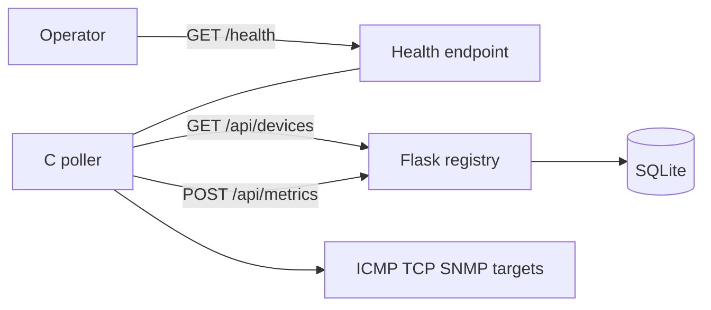

# NetPulse

NetPulse is a small Linux monitoring agent. A multithreaded C poller runs ICMP, TCP, and SNMP checks against devices registered in a Flask service, and writes one JSON metric per line. The registry stores devices and results in SQLite. Both processes run on a laptop or under Docker Compose.

## Features

- A pthread worker pool polls every registered device. Each check uses POSIX sockets: ICMP echo, a non-blocking TCP connect, and an SNMP v2c GET through net-snmp.
- Metrics are JSON objects on stdout. Logs are JSON objects on stderr, so the two streams can be shipped separately.
- The agent serves `GET /health` and `GET /ready` for troubleshooting.
- The registry is the source of device records. A pipe-separated devices file is the fallback when the registry is down, and is enough to run the agent on its own.
- The C sources build with `-Wall -Wextra -Werror`. GitHub Actions runs the unit tests under Valgrind.
- Docker Compose starts the registry, a local `snmpd`, and the agent.

## Architecture



The main thread loads the device list and pushes one job per enabled check onto a bounded queue. Worker threads pop jobs, run the probe, print the metric, and optionally POST it back to the registry. A separate thread accepts health connections. SIGINT and SIGTERM stop the scheduler; workers finish the check they are in and then exit.

ICMP prefers an unprivileged datagram socket (`SOCK_DGRAM`, `IPPROTO_ICMP`), which Linux allows when `ping_group_range` includes the process. If that open fails, the probe falls back to a raw socket, which needs `CAP_NET_RAW`. SNMP calls go through `snmp_sess_*`, the net-snmp API that is safe to use from more than one thread.

## Layout

```
agent/                 C poller, probes, and unit tests
registry/              Flask app, SQLite schema, API tests
examples/devices.local sample device file
docker/                Dockerfiles and snmpd config
scripts/dev-snmpd.sh   local SNMP agent on UDP 1161
.github/workflows/ci.yml
docker-compose.yml
```

## Configuration

Copy `.env.example` if you want the variables in one place. The processes read the environment directly; they do not load a dotenv file.

| Variable | Role |
| --- | --- |
| `NETPULSE_REGISTRY_URL` | `http://host:port` of the registry. Plain HTTP only. |
| `NETPULSE_DEVICES_FILE` | Fallback device list. Used alone, or when a fetch fails. |
| `NETPULSE_POLL_INTERVAL` | Seconds between cycles. Default 15. |
| `NETPULSE_WORKERS` | Worker threads. Default 4. |
| `NETPULSE_HEALTH_ADDR` / `NETPULSE_HEALTH_PORT` | Health listener. Port 0 turns it off. |
| `NETPULSE_CHECK_TIMEOUT_MS` | Probe and registry call timeout. Default 2000. |
| `NETPULSE_LOG_LEVEL` | `error`, `warn`, `info`, or `debug`. |
| `NETPULSE_RUN_ONCE` | Run a single cycle and exit. |
| `NETPULSE_DB` | SQLite path for the registry. |
| `NETPULSE_SEED` | Insert the two demo devices when the table is empty. |

Device file columns, separated by `|`:

```
id|name|host|icmp|tcp_port|snmp_port|community|oid
```

`icmp` is `0` or `1`. A `tcp_port` of `0` skips TCP. Empty `community` or `oid` skips SNMP.

## Run locally

Dependencies: gcc, pkg-config, libsnmp, Python 3.12, and (for the SNMP demo) snmpd. On Debian or Ubuntu:

```sh
sudo apt-get install build-essential pkg-config libsnmp-dev snmp snmpd python3-venv
sudo sysctl -w net.ipv4.ping_group_range="0 2147483647"
```

The sysctl lets the agent send ICMP without root. Skip it and run the agent as root if you would rather use a raw socket.

```sh
make
python3 -m venv .venv
.venv/bin/pip install -r registry/requirements-dev.txt
```

The registry process is started from `registry/` so `wsgi:app` resolves. `NETPULSE_SEED_SNMP_PORT` matches `scripts/dev-snmpd.sh`, which listens on UDP 1161.

```sh
cd registry
NETPULSE_SEED=1 NETPULSE_SEED_SNMP_PORT=1161 NETPULSE_DB=netpulse.db \
  ../.venv/bin/gunicorn -b 127.0.0.1:5000 -w 1 wsgi:app
```

In a second shell, from the repo root:

```sh
./scripts/dev-snmpd.sh
```

And in a third:

```sh
NETPULSE_REGISTRY_URL=http://127.0.0.1:5000 ./build/netpulse
```

Metrics print on the agent terminal. Open `http://127.0.0.1:5000/` for the device table and `http://127.0.0.1:8080/health` for the agent.

To poll a file once and exit, without the registry:

```sh
NETPULSE_DEVICES_FILE=examples/devices.local ./build/netpulse --run-once
```

Register a device by hand:

```sh
curl -s -X POST http://127.0.0.1:5000/api/devices \
  -H 'Content-Type: application/json' \
  -d '{"name":"edge-1","host":"192.0.2.10","icmp_enabled":true,"tcp_port":22}'
```

`PUT /api/devices/<id>` replaces the record. Omit `tcp_port`, or send `null`, to clear it. SNMP is stored only when both `snmp_community` and `snmp_oid` are set; `snmp_port` defaults to 161.

## Docker

```sh
docker compose up --build
```

The registry listens on port 5000, the agent health port on 8080, and `snmpd` on UDP 1161. The agent container is started with `CAP_NET_RAW` so ICMP echo works. The SQLite file lives in the `registry-data` volume.

## Tests

```sh
make test
make valgrind
make test-registry PY=.venv/bin/python
```

`make test` builds `build/netpulse-tests` and runs the C checks: JSON, the device file, the queue, ICMP (skipped when the socket is refused), TCP against a local listener, SNMP against a short-lived `snmpd`, the registry HTTP client, the health server, and one poller cycle. `make valgrind` runs that binary with `--leak-check=full` and a non-zero exit on definite leaks. The registry tests cover create, update, delete, validation, metric storage, cascade delete, and the HTML page.

GitHub Actions runs those three jobs plus `docker compose build`.

## Design notes

The registry speaks JSON because that is what the agent already emits. A small parser in the agent reads the device list; it is not a general-purpose library, and it rejects trailing junk.

There is no authentication. The registry is meant to sit on a private network next to the agent. Community strings are stored in SQLite as the device record, and they are not written to the log.

Checks are IPv4. Hostnames are resolved with `getaddrinfo` on every probe, which keeps the code path obvious at the cost of a lookup per attempt.

SNMP is v2c GET of one numeric OID. Symbolic MIB names are not loaded; distributions often ship the library without MIB files, and a numeric OID is enough for `sysDescr` and similar objects.

Stdout is the metric stream and stderr is the log stream. A failure to POST a result is logged and the metric is still printed, so a registry outage does not drop the sample on the floor.
